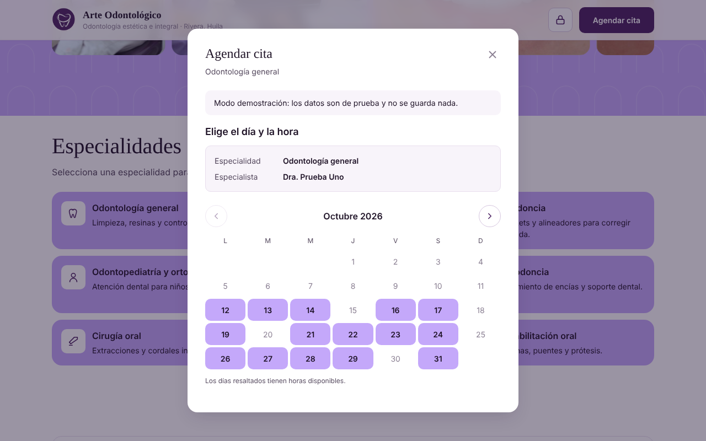
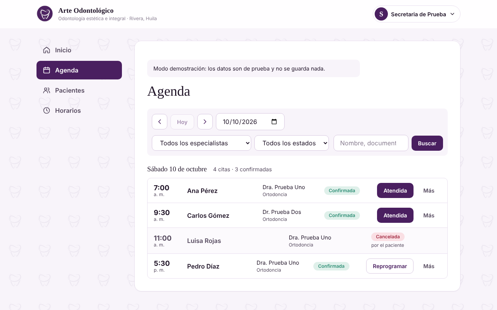

# Arte Odontológico — Sistema web de citas

[](https://github.com/emmanuelartunduagach-hue/arte-odontologico/actions/workflows/ci.yml)

Proyecto de aplicación · Ingeniería de Software · Fundación Escuela Tecnológica de Neiva Jesús Oviedo Pérez (FET)
Emmanuel Artunduaga Charry · Jawer Leonardo Manrique Yosa

Aplicación web para el consultorio odontológico Arte Odontológico (sede Rivera, Huila).
Las personas piden su cita en línea sin crear una cuenta y reciben por WhatsApp la
confirmación, los cambios y el recordatorio. La secretaria y la propietaria administran
desde un panel la agenda, los horarios, los pacientes, la historia clínica y el odontograma.

Publicada en: <https://arte-odontologico-production.up.railway.app>

## Qué hace

- **Paciente (sin cuenta):** elige especialidad, especialista, día y hora; deja sus datos y
  la autorización de tratamiento de datos; la cita queda confirmada. Con el enlace
  «Gestionar mi cita» del WhatsApp reprograma una vez o cancela, hasta 24 horas antes.
- **Secretaria (rol `administrador`):** agenda, horarios por especialista, pacientes, historia
  clínica (solo inserciones) y odontograma.
- **Propietaria (rol `superadmin`):** todo lo anterior, más aprobar las correcciones de la
  historia y las anulaciones del odontograma, administrar al equipo y a los especialistas.

## Capturas

Tomadas en el modo demostración (datos ficticios); más en `docs/capturas/`.

| Página pública | Agendar una cita | Panel de la secretaria |
|---|---|---|
|  |  |  |

## Tecnologías

| Capa | Tecnología |
|---|---|
| Servidor | Node.js 20 o superior, Express 4 |
| Base de datos | MySQL 8 (11 tablas y una vista; esquema en `backend/database/schema.sql`) |
| Sesión y claves | JWT (8 horas por defecto) y bcrypt |
| Cliente | HTML, CSS y JavaScript sin framework, entregado por el mismo servidor |
| Mensajes | WhatsApp: modo manual, consola, Twilio (pruebas) o API de WhatsApp Cloud (Meta) |
| Publicación | Railway (la app y MySQL), con nuevo despliegue en cada cambio de `main` |

## Estructura

```
arte-odontologico/
├── package.json              Instala el backend y lo arranca (publicación en Railway)
├── .github/workflows/        Verificación automática en cada pull request (pruebas, auditoría, sintaxis)
├── backend/                  API REST (Node.js + Express + MySQL)
│   ├── database/
│   │   ├── schema.sql        Esquema completo (instalación nueva)
│   │   └── migraciones/      001–007, para bases existentes
│   └── src/
│       ├── config/           Conexión a MySQL
│       ├── routes/           Definición de endpoints
│       ├── controllers/      Validación y reglas de negocio
│       ├── models/           Consultas SQL
│       ├── middleware/       Sesión, rol y límite de peticiones
│       ├── services/         Notificaciones de WhatsApp y recordatorios
│       ├── utils/            Validaciones, fechas, códigos, paginación, configuración y errores
│       └── scripts/          Administrador, propietaria, recordatorios y datos de demostración
│   └── tests/                Pruebas unitarias sin base de datos (npm test)
├── frontend/                 Cliente en HTML, CSS y JavaScript (sin framework)
│   ├── index.html            Página pública y flujo de agendar
│   ├── gestionar-cita.html   Reprogramar o cancelar con el enlace
│   ├── panel-secretaria.html Panel (secretaria y propietaria)
│   ├── politica-datos.html   Política de tratamiento de datos
│   ├── css/                  tokens.css → base.css → [pantalla].css
│   ├── js/                   Un módulo por pantalla y módulos comunes
│   └── assets/img/
└── docs/                     Documentación (ver docs/README.md)
```

## Un solo repositorio

El servidor (`backend/`), el cliente (`frontend/`) y la documentación (`docs/`) viven en el mismo
repositorio. Es una decisión de diseño, no una carencia:

- **Se publican juntos.** El servidor Express entrega también los archivos del cliente, así que
  la aplicación es un solo servicio en Railway, con un solo dominio. No hay una segunda aplicación
  que desplegar ni una dirección de API que configurar en el cliente (`frontend/js/config.js` usa
  `/api` en el mismo dominio).
- **Un cambio, un pull request.** Cuando una mejora toca la API y la pantalla que la usa (por
  ejemplo, la paginación de pacientes), ambas partes se revisan y se verifican juntas y nunca
  quedan en versiones distintas.
- **Una sola versión, un solo historial.** La versión, la verificación automática de GitHub
  Actions y la documentación son únicas para todo el sistema.
- **La responsabilidad sigue separada.** Emmanuel mantiene `backend/` y Jawer `frontend/`; entre
  ambas carpetas solo hay un contrato, el de la API (`docs/03-diseno/contrato-api.md`). Separarlos
  más adelante en dos repositorios exigiría únicamente apuntar el cliente a la dirección de la
  API y permitir ese origen en el servidor (`ORIGEN_PERMITIDO`).

## Instalación en desarrollo

**Requisitos:** Node.js 20 o superior, MySQL 8.

```bash
# 1. Base de datos
mysql -u root -p < backend/database/schema.sql

# 2. Backend
cd backend
cp .env.example .env      # completar credenciales (ver «Configuración»)
npm install
npm run crear-admin       # cuenta de la secretaria
npm run dev               # http://localhost:3000/api

# 3. Frontend
# Con el backend encendido, también se entrega en http://localhost:3000
# o se abre frontend/index.html con Live Server (http://localhost:5500).
```

Para la propietaria: `npm run superadmin` (pide la clave `SUPERADMIN_CLAVE` del `.env`).
La instalación completa y la publicación en Railway están en
`docs/04-manuales/manual-instalacion.md`.

### Comandos

Se ejecutan desde `backend/`, salvo el primero, que es el de la raíz.

| Comando | Para qué sirve |
|---|---|
| `npm start` (raíz) | Arranca el servidor como lo hace Railway (instala el backend en `postinstall`) |
| `npm run dev` | Desarrollo: se reinicia solo al guardar |
| `npm test` | Pruebas unitarias (no necesitan base de datos); también corren en GitHub Actions en cada PR |
| `npm start` | Producción |
| `npm run crear-admin` | Crea la cuenta de la secretaria |
| `npm run restablecer-admin` | Restablece la contraseña de la secretaria |
| `npm run superadmin` | Crea o edita la cuenta de la propietaria (pide `SUPERADMIN_CLAVE`) |
| `npm run recordatorios` | Genera una vez los recordatorios de las citas de las próximas 24 horas |
| `npm run datos-demo` | Carga especialistas y citas ficticias en una base de desarrollo (se niega a correr con `NODE_ENV=production`) |

## Configuración

Toda la configuración sale de variables de entorno. `backend/.env.example` las lista con su
explicación; se copia como `.env` y nunca se sube a Git. Las principales:

| Variable | Qué controla |
|---|---|
| `DB_HOST`, `DB_PORT`, `DB_USER`, `DB_PASSWORD`, `DB_NAME` | Conexión a MySQL |
| `JWT_SECRET`, `JWT_EXPIRA` | Firma y duración de la sesión |
| `URL_PUBLICA` | Dominio de los enlaces «Gestionar mi cita» |
| `PROXY_CONFIABLE` | `1` detrás del proxy de Railway, para que el límite de peticiones vea la IP real |
| `WHATSAPP_MODO` | `manual`, `consola`, `twilio` o `api` |
| `HORAS_MINIMAS_GESTION`, `LIMITE_*` | Reglas de las citas y límites de peticiones por IP |
| `RECORDATORIOS_AUTOMATICOS`, `RECORDATORIO_*` | Recordatorio 24 horas antes y su horario (hora de Colombia) |
| `SUPERADMIN_CLAVE` | Clave técnica para crear la cuenta de la propietaria |

## Modo demostración

Para revisar o capturar pantallas sin base de datos, el frontend simula la API cuando se abre
en `localhost` con `?demo=1` (por ejemplo `http://localhost:5500/index.html?demo=1`). Con
`?demo=0` se apaga. En un dominio publicado este modo nunca se activa. Cuentas de la
demostración: `secretaria@demo.co` y `dueno@demo.co`, ambas con la clave `Demo1234`.

## Interfaz

- **Página pública:** el carrusel de fotos avanza solo y se detiene mientras la persona lo toca;
  se mueve en ambos sentidos con el dedo, arrastrando con el mouse, con las flechas del teclado
  o con los botones anterior, pausa y siguiente. Respeta la preferencia «reducir movimiento» del
  sistema. En celular, los textos van centrados.
- **Panel:** en celular, la secretaria navega con una barra inferior y la propietaria con un menú
  lateral que se abre desde el botón de hamburguesa. En escritorio, ambas con la barra lateral.
- **Modo claro y oscuro** en el panel, y colores definidos solo en `tokens.css`.

## Pruebas

La estrategia, los resultados y las guías manuales están en `docs/06-pruebas/pruebas.md`.
Las guías en PowerShell de esa carpeta se ejecutan a mano con la base local; la de
`pruebas-agenda-citas.txt` corresponde al modelo anterior al 22 de octubre (su encabezado lo
indica) y la vigente es `pruebas-alta-pacientes.txt`.

## Publicación

Railway publica de nuevo cada vez que se fusiona un cambio en `main`. El paso a paso (variables,
creación de tablas, dominio, cuentas y respaldos) está en la sección 8.2 de
`docs/04-manuales/manual-instalacion.md`. Para verificar una publicación:
`https://DOMINIO/api/salud` debe responder `{"estado":"ok"}`.

## Flujo de trabajo en Git

- `main` es la rama publicada: cada fusión redespliega en Railway. No se trabaja directamente en ella.
- Cada tarea tiene su propia rama, creada desde `main`, con prefijo según el tipo: `feature/` (funcionalidad nueva),
  `fix/` (corrección) o `docs/` (documentación).
- Los cambios entran por pull request (hay una plantilla en `.github/`). La verificación automática
  debe pasar antes de fusionar.
- Las tareas se llevan en un tablero Kanban de Trello (backlog, sprint, en progreso, en revisión, hecho).
- Los commits describen el cambio en español y en pocas palabras; cada persona firma con su propio usuario.
- Las decisiones técnicas se registran en `docs/decisiones-tecnicas.md`.

## Seguridad del repositorio

- No se suben `.env`, `.env.*` (salvo `.env.example`) ni respaldos `*.sql`; el `.gitignore` los
  excluye. Los únicos `.sql` versionados son el esquema y las migraciones.
- Los datos de pacientes son confidenciales: ninguna captura, documento o prueba debe mostrar datos
  reales. Las capturas de los manuales salen del modo demostración.
- Las claves y tokens (base de datos, JWT, WhatsApp) viven solo en las variables de entorno de
  Railway y en el `.env` local.

## Arquitectura del CSS

Los estilos se cargan en cascada y en este orden:

1. `tokens.css` — variables de color, tipografía, espaciado y sombras. Única fuente de
   valores; no debe haber colores sueltos fuera de este archivo.
2. `base.css` — reset, tipografía y componentes compartidos.
3. `[pantalla].css` — estilos exclusivos de cada pantalla (`landing.css`, `panel.css`).

## Documentación

Todo está en `docs/` (índice en `docs/README.md`): alcance, modelo de datos y diagramas, contrato de
la API, decisiones técnicas, manuales de instalación, técnico y de usuario, y pruebas. Los `.md` son
la fuente editable; `docs/para-drive/` tiene las versiones en Word para el Drive del proyecto.

## Alcance y pendientes

Lo que queda fuera de la versión 1.0, declarado a propósito:

- El envío automático por la API oficial de WhatsApp (Meta) espera la aprobación de las plantillas;
  mientras tanto se usa el modo manual o el sandbox de Twilio, que solo sirve para pruebas.
- No se hizo la evaluación formal de usabilidad (ISO 9241-11) ni la auditoría de accesibilidad (WCAG 2.2).
- El efecto de los recordatorios sobre las inasistencias no se ha medido.
- El script de las pruebas de integración contra MySQL (140 comprobaciones, más 53 del rol de la
  propietaria) no está en el repositorio; los resultados están documentados en `docs/06-pruebas/pruebas.md`.

## Versiones

La versión actual es la **1.0.0** (entrega final). Los cambios están en [`CHANGELOG.md`](CHANGELOG.md) y las versiones publicadas, en la pestaña *Releases* de GitHub.

## Equipo

| Persona | Responsabilidad |
|---|---|
| Emmanuel Artunduaga Charry | Backend, base de datos y documentación |
| Jawer Leonardo Manrique Yosa | Frontend |

Proyecto de grado PF-TC-2026-015 · Ingeniería de Software · FET, Neiva.
