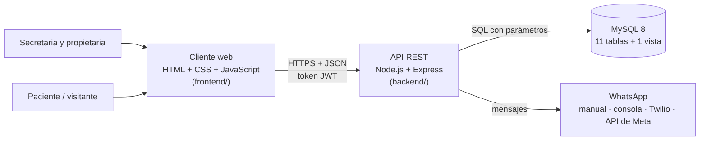

# Manual técnico — Arte Odontológico

**Proyecto:** plataforma web de agendamiento de citas para el consultorio Arte Odontológico\
**Programa:** Ingeniería de Software — Fundación Escuela Tecnológica de Neiva Jesús Oviedo Pérez\
**Autores:** Emmanuel Artunduaga Charry · Jawer Leonardo Manrique Yosa\
**Versión del documento:** 1.0 (borrador) · 22 de octubre de 2026

> Pendiente: paso a la plantilla oficial de la FET. El despliegue está en el *Manual de instalación* (sección 8).

## 1. Propósito y alcance

Describe cómo está construido el sistema: arquitectura, organización del código, modelo de datos, API, reglas de negocio, seguridad y pruebas. Está dirigido a quien mantenga o amplíe el sistema. Para instalarlo, ver el *Manual de instalación*.

El sistema permite que cualquier persona pida una cita odontológica desde la web sin crear cuenta, eligiendo especialidad, especialista, día y hora. La cita queda **confirmada de una vez** (decisión 27) y el paciente recibe por WhatsApp la confirmación con un enlace para reprogramar una vez o cancelar, y unas 24 horas antes, un recordatorio. Inician sesión dos perfiles: la secretaria (rol `administrador`), que gestiona agenda, horarios, pacientes, historia clínica y odontograma, y la propietaria (rol `superadmin`), que además aprueba las correcciones de la historia y las anulaciones del odontograma y administra al equipo y a los especialistas. Los pacientes no tienen cuenta: son una ficha que se crea o se enlaza al pedir su primera cita, o que la secretaria registra si llegan al consultorio.

## 2. Arquitectura

Arquitectura cliente-servidor en tres capas:

- **Cliente:** páginas estáticas que consumen la API con `fetch`. No guardan lógica de negocio: toda regla se valida en el servidor.
- **API:** Express organizado por capas (rutas → controladores → modelos), sin ORM. Las consultas SQL están escritas a mano con parámetros (`?`).
- **Base de datos:** MySQL 8 con InnoDB, `utf8mb4`, integridad referencial con llaves foráneas y restricciones únicas que hacen cumplir reglas del negocio (por ejemplo, una sola cita viva por hora).

## 3. Tecnologías

| Capa | Tecnología | Versión | Uso |
|---|---|---|---|
| Servidor | Node.js | 20 o superior | Entorno de ejecución |
| | Express | 4.x | Servidor HTTP y enrutamiento |
| | mysql2 | 3.x | Conexión a MySQL con pool y consultas preparadas |
| | bcrypt | 6.x | Cifrado de contraseñas (10 rondas) |
| | jsonwebtoken | 9.x | Sesiones con token firmado (JWT) |
| | dotenv, cors | — | Configuración y política de origen |
| Datos | MySQL | 8.0+ | Base de datos relacional |
| Cliente | HTML5, CSS3, JavaScript (ES2020) | — | Interfaz sin frameworks |
| Mensajería | WhatsApp Cloud API de Meta o Twilio (opcionales) | Graph API v21 | Envío automático de mensajes |
| Publicación | Railway (plan Hobby) | — | App y MySQL en un mismo proyecto, con HTTPS |
| Control de versiones | Git + GitHub | — | Ramas por tarea y Pull Requests |

No hay más dependencias de producción: las funciones de fecha, aleatoriedad y hash usan los módulos nativos de Node (`Intl`, `crypto`).

## 4. Organización del código

| Carpeta o archivo | Contenido |
|---|---|
| `backend/database/schema.sql` | Esquema completo y datos iniciales (instalación nueva) |
| `backend/database/migraciones/` | Cambios para bases existentes, en orden (001, 002…) |
| `backend/src/server.js` | Arranque: prueba la conexión y abre el puerto |
| `backend/src/app.js` | Express, CORS, JSON, rutas y manejador de errores |
| `backend/src/config/db.js` | Pool de conexiones MySQL |
| `backend/src/routes/` | Qué URL va a qué controlador y con qué permisos |
| `backend/src/controllers/` | Validación de entrada, reglas de negocio y respuesta |
| `backend/src/models/` | Consultas SQL |
| `backend/src/middleware/` | Sesión, rol y límite de peticiones |
| `backend/src/services/notificaciones/` | Textos y envío de WhatsApp |
| `backend/src/utils/` | Validaciones, fechas, códigos, errores, contraseñas |
| `backend/src/scripts/` | Consola: `crearAdmin.js` (crear la secretaria), `restablecerAdmin.js` (restablecer su clave), `superadmin.js` (crear o editar a la propietaria, con `SUPERADMIN_CLAVE`), `enviarRecordatorios.js` y `datosDemo.js` (solo desarrollo; se bloquea en producción) |
| `backend/src/services/recordatorios.js` | Recordatorio 24 horas antes y su ejecución automática |
| `backend/.env.example` | Plantilla de configuración |
| `frontend/` | Páginas públicas (`index.html`, `gestionar-cita.html`, `politica-datos.html`) y con sesión (`cambiar-contrasena.html`, `panel-secretaria.html`); `css/` (`tokens.css` → `base.css` → `landing.css` y `panel.css`); `js/` (`config.js`, `api.js`, `sesion.js`, `tema.js`, módulos comunes `comun.js` y `modales.js`, y un módulo por pantalla). El panel es una sola página con secciones por fragmento de URL (`#inicio`, `#agenda`, `#pacientes/12`…): `panel-secretaria.js` las monta y arma Inicio (novedades de la web, WhatsApp sin enviar y agenda de hoy); `panel-comun.js` tiene los diálogos y avisos; y cada sección vive en su archivo: `panel-agenda.js`, `panel-pacientes.js` (lista, registro, ficha con citas e historia clínica), `panel-odontograma.js`, `panel-disponibilidad.js` (editor de horario por día), `panel-mensajes.js` (tarjeta de un WhatsApp sin enviar) y `panel-superadmin.js` (Solicitudes, Equipo y Especialistas, solo para la propietaria). `api-demo.js` es una API simulada que solo se activa en localhost con `?demo=1` |
| `docs/` | Documentación del proyecto |

**Flujo de una petición:** `routes` aplica los middlewares (sesión, rol, límite) → el `controller` valida el cuerpo con `utils/validaciones`, aplica las reglas y llama a los `models` → si algo falla lanza un `ErrorHttp(status, mensaje, campos)` → el manejador central de `app.js` responde `{ error, campos? }` sin exponer detalles internos (la traza completa queda solo en la consola del servidor).

## 5. Modelo de datos

El detalle de cada tabla y el diagrama entidad-relación están en `docs/03-diseno/modelo-de-datos.md`. Resumen:

| Tabla | Propósito |
|---|---|
| `usuarios` | Quienes inician sesión: la secretaria (`administrador`) y la propietaria (`superadmin`) |
| `pacientes` | Ficha de cada paciente (sin usuario ni contraseña), con su origen (web o consultorio), tipo de documento, teléfono fijo y motivo de consulta |
| `servicios` | Especialidades del consultorio |
| `especialistas` | Odontólogos; no inician sesión. Perfil interno con título y foto (solo lo ve la propietaria) |
| `especialista_especialidad` | Qué especialidades atiende cada especialista (muchos a muchos) |
| `sedes` | Sede de atención (hoy solo Rivera) |
| `franjas_horarias` | Horas publicadas a mano por la secretaria, por especialista y fecha |
| `citas` | Citas, con los datos de quien la pidió y su origen (web o consultorio); nacen confirmadas |
| `notificaciones` | Bitácora de mensajes de WhatsApp |
| `historia_clinica` | Entradas por paciente; no se modifican ni se borran; las correcciones tienen estado (vigente, pendiente o rechazada) |
| `odontograma` | Hallazgos por diente y cara (numeración FDI), con aprobación de anulaciones |
| `v_agenda` (vista) | Agenda con paciente, especialidad, especialista y sede |

## 6. API REST

Todas las rutas cuelgan de `/api` y responden JSON. El contrato completo con ejemplos está en `docs/03-diseno/contrato-api.md`.

| Grupo | Método y ruta | Acceso |
|---|---|---|
| Salud | `GET /salud` | Público |
| Catálogo | `GET /especialidades` · `GET /especialidades/:id/especialistas` | Público |
| Calendario | `GET /especialistas/:id/calendario?mes=` · `GET /especialistas/:id/horas?fecha=` | Público |
| Pedir cita | `POST /citas` (queda confirmada) | Público |
| Gestionar cita | `GET /citas/gestion/:codigo` · `POST …/reprogramar` · `POST …/cancelar` | Público con código |
| Sesión | `POST /auth/ingreso` · `POST /auth/cambiar-contrasena` · `GET /auth/perfil` | Público / sesión |
| Novedades y agenda | `GET /admin/citas` · `GET /admin/citas/novedades` · `POST /admin/citas` · `POST /admin/citas/:id/aceptar` · `POST /admin/citas/:id/rechazar` · `PATCH /admin/citas/:id/estado` · `POST /admin/citas/:id/reprogramar` | Rol administrador |
| Pacientes | `POST /pacientes` · `GET /pacientes?q=` · `GET /pacientes/:id` | Rol administrador |
| Historia clínica | `GET/POST /pacientes/:id/historia` · `POST /admin/historia/:id/correccion` | Rol administrador (la corrección queda pendiente hasta que la apruebe la propietaria) |
| Odontograma | `GET/POST /pacientes/:id/odontograma` · `POST /admin/odontograma/:id/realizado` · `POST /admin/odontograma/:id/anular` | Rol administrador |
| Solicitudes y equipo | `GET /superadmin/solicitudes` · `POST /superadmin/solicitudes/historia\|odontograma/:id/aprobar\|rechazar` · `GET/POST/PATCH/DELETE /superadmin/administradores` · `POST /superadmin/administradores/:id/restablecer` | Solo la propietaria (superadmin) |
| Especialidades | `GET/POST /admin/especialidades` · `PATCH /admin/especialidades/:id` | Rol administrador |
| Especialistas | `GET /admin/especialistas` (lista) | Rol administrador |
| Especialistas: crear, editar y foto | `GET/POST /superadmin/especialistas` · `PATCH /superadmin/especialistas/:id` · `PUT/DELETE /superadmin/especialistas/:id/foto` | Solo la dueña (superadmin) |
| Disponibilidad | `GET/POST /admin/especialistas/:id/franjas` · `DELETE /admin/franjas/:id` | Rol administrador |
| Agenda | `GET /admin/citas` · `PATCH /admin/citas/:id/estado` · `POST /admin/citas/:id/reprogramar` | Rol administrador |
| Mensajes | `GET /admin/notificaciones` · `PATCH /admin/notificaciones/:id` · `POST /admin/recordatorios` | Rol administrador |

En total son 54 rutas bajo `/api`. «Rol administrador» incluye a la propietaria: `requiereRol` deja pasar al `superadmin` en cualquier control.

**Códigos de respuesta:**
- 200 / 201: correcto.
- 400: datos inválidos, con `campos` por cada error.
- 401: sin sesión o sesión vencida.
- 403: sin permiso.
- 404: no existe.
- 409: conflicto con una regla del negocio, por ejemplo una hora ya tomada.
- 429: demasiadas peticiones.
- 500: error interno, con mensaje genérico.

## 7. Reglas de negocio y cómo se implementan

| Regla | Implementación |
|---|---|
| Una hora admite una sola cita viva | Columna generada `citas.franja_ocupada = IF(estado IN ('cancelada','rechazada'), NULL, franja_id)` con índice único. Si dos personas piden la misma hora a la vez, el motor rechaza la segunda (`ER_DUP_ENTRY` → 409). Una pendiente ya aparta la hora; al cancelar o rechazar, se libera sola |
| La cita pedida por la web queda confirmada (decisión 27) | `citas.controller.crear`: crea la cita confirmada con `origen = 'web'`, crea o enlaza la ficha (`pacienteParaCitaWeb`: solo enlaza si coincide el celular o el correo) y envía la confirmación con el enlace |
| Aceptar (citas pendientes antiguas) crea o enlaza la ficha | `aceptar` → `pacienteDeCita`: busca por documento y, si no existe, crea el paciente con los datos y la autorización de la cita; luego `cita.model.aceptar` y WhatsApp de confirmación con enlace |
| Rechazar (citas pendientes antiguas) libera la hora | `rechazar`: estado `rechazada` y WhatsApp de tipo `rechazo` |
| La cita que agenda la secretaria queda confirmada | `crearAdmin` (`POST /admin/citas`) con los datos de la ficha |
| Pedir cita sin cuenta con nombres, apellidos, tipo y número de documento, celular y correo (teléfono fijo opcional) | `validarDatosPersona`; el celular se normaliza con indicativo 57; el pasaporte admite letras. `nombre_completo` y `nombre_paciente` son columnas generadas (nombres + apellidos) |
| Autorización de datos obligatoria (Ley 1581 de 2012) | `autorizacionDatos === true`; se guarda la fecha y la versión de la política en la cita |
| Máximo 1 cita pendiente o confirmada por documento | `contarActivasPorDocumento`; configurable con `LIMITE_CITAS_ACTIVAS_POR_DOCUMENTO` |
| El paciente reprograma una sola vez y el cambio queda confirmado | `UPDATE … SET franja_anterior_id = franja_id, … WHERE estado = 'confirmada' AND reprogramaciones < 1`; el aviso lleva el mismo enlace (la condición va en la misma sentencia para evitar dobles clics) |
| Reprogramar o cancelar hasta 24 h antes | `reglasGestion` compara la fecha y hora de la cita con la hora de Bogotá + 24 h |
| La secretaria reprograma sin límite y puede cambiar de especialista | `reprogramarAdmin` no toca el contador; valida que el especialista atienda la especialidad |
| No quitar una hora con cita | `quitarFranja` responde 409 si hay cita viva; si no, la desactiva (no la borra) |
| Marcar asistencia solo cuando llegó la hora | `cambiarEstado` compara con la hora actual |
| Las citas canceladas no se borran | Estado `cancelada` y `cancelada_por` |
| Límite de intentos de ingreso | `limitePeticiones` en `POST /auth/ingreso`: 10 por IP cada 15 minutos, configurable con `LIMITE_INGRESOS_POR_IP` |
| Clave temporal obligatoria de cambiar | El ingreso devuelve `debeCambiarContrasena`; `exigirSesion()` en `frontend/js/sesion.js` lleva a `cambiar-contrasena.html` antes de cualquier panel |
| Historia clínica inalterable | Solo hay `INSERT`; la corrección es una entrada nueva con `corrige_a` |
| Solo el personal inicia sesión | El ingreso rechaza cualquier usuario que no esté activo ni tenga rol `administrador` o `superadmin`; los pacientes están en otra tabla, sin contraseña |
| Sesión cortada al instante | `middleware/autenticacion.js` consulta en la base el rol y si el usuario sigue activo en cada petición; si cambió, responde 401 aunque el token no haya vencido |
| La propietaria solo se crea desde el servidor | `npm run superadmin` exige `SUPERADMIN_CLAVE` (mínimo 16 caracteres, comparada con `timingSafeEqual`); no existe ruta web |
| Correcciones y anulaciones con aprobación | Una corrección o anulación pedida por un administrador queda `pendiente`; la propietaria la aprueba o la rechaza con motivo. Lo que ella pide queda vigente de una vez |
| Hallazgos del odontograma válidos | `odontograma.controller.js` define el catálogo de hallazgos y valida el diente con numeración FDI (`esDienteFdi`) |
| Recordatorio 24 horas antes, una sola vez | `services/recordatorios.js`: cada 30 min dentro de `RECORDATORIO_DESDE`–`RECORDATORIO_HASTA`; citas confirmadas que empiezan en las próximas 24 h, aceptadas hace más de 12 h y sin recordatorio posterior a su última confirmación o reprogramación |
| "Olvidé mi contraseña" | La secretaria: por consola con `npm run restablecer-admin`. Un administrador: la propietaria genera una clave temporal desde Equipo. La propietaria: `npm run superadmin` |

**Zona horaria.** Las franjas guardan fecha y hora locales del consultorio. `utils/tiempo.js` calcula la hora actual de Bogotá (UTC-5) con `Intl` y la pasa a las consultas como texto, de modo que el resultado no depende de la zona horaria del servidor donde se publique.

## 8. Seguridad

| Riesgo | Medida |
|---|---|
| Robo de contraseñas | bcrypt con 10 rondas; nunca se guardan ni se devuelven en texto plano. Solo la secretaria tiene contraseña |
| Suplantación de rol | El rol viaja dentro del JWT firmado por el servidor y se verifica en cada ruta con `requiereRol`; el cliente nunca lo envía |
| Adivinar correos registrados | El ingreso responde el mismo mensaje y tarda lo mismo si el correo no existe (comparación contra un hash de relleno) |
| Inyección SQL | Todas las consultas usan parámetros; las búsquedas escapan los comodines de `LIKE` |
| Enlaces de gestión adivinables | Código aleatorio de 32 bytes; en `citas` solo se guarda su hash SHA-256. El enlace se genera al pedir la cita y sigue sirviendo cuando el paciente reprograma; si la secretaria reprograma, se genera uno nuevo y el anterior deja de servir. Al marcar un mensaje como enviado, el código se borra del texto guardado |
| Bots que llenan la agenda | Límite de peticiones por IP, campo trampa oculto en el formulario y máximo de citas activas por documento |
| Fuga de datos en mensajes | El WhatsApp solo lleva fecha, hora, especialista y dirección; nada clínico |
| Errores que revelan detalles internos | Manejador central: mensaje genérico al cliente, traza solo en el servidor |
| Peticiones enormes | Cuerpo JSON limitado a 100 KB; listas de fechas y horas con tope |
| Secretos en el repositorio | `.env` y `.env.*` en `.gitignore` (también los `.sql` de respaldo); solo se publica `.env.example` |
| Sesión olvidada en un equipo compartido | El token se guarda en `sessionStorage` (se borra al cerrar la pestaña) y el texto de la API se pinta siempre con `textContent` |

**Limitaciones conocidas:**
- Si `ORIGEN_PERMITIDO` no está definido, CORS acepta cualquier origen; en la publicación app y API comparten dominio, así que se puede restringir sin cambiar código.
- El límite de peticiones por IP vive en la memoria del proceso: se reinicia con el servidor y no se comparte entre instancias.
- No se usan cabeceras de seguridad adicionales (por ejemplo, `helmet`).
- El acceso público a MySQL en Railway está pendiente de cerrar.
- No hay autenticación de dos factores.

## 9. Notificaciones

`services/notificaciones/NotificacionService.notificarCita({ citaId, tipo, codigo })` arma el texto (`mensajes.js`), lo guarda en `notificaciones` y lo entrega a `ProveedorWhatsApp` según `WHATSAPP_MODO`:

- **manual:** queda pendiente. El panel muestra un enlace `https://wa.me/<número>?text=<mensaje>` que abre el WhatsApp Business de la clínica con el texto listo.
- **consola:** se imprime en la terminal del backend.
- **twilio:** se envía el texto completo con el WhatsApp Sandbox de Twilio; es solo para pruebas.
- **api:** se envía con una plantilla aprobada por la API de WhatsApp Cloud (Meta).

El servicio nunca lanza errores hacia el controlador: si el envío falla, la cita sigue confirmada y el mensaje queda como `fallida` para enviarlo a mano. Tipos: `confirmacion` (al pedir la cita), `reprogramacion`, `cancelacion`, `rechazo` y `recordatorio`. Solo los dos primeros llevan el enlace de gestión: el recordatorio sale cuando ya pasó el plazo de 24 horas, y la cancelación y el rechazo llevan la dirección de la página para pedir otra cita.

El recordatorio lo genera `services/recordatorios.js`, programado desde `server.js` cada 30 minutos (se desactiva con `RECORDATORIOS_AUTOMATICOS=false`). También se puede lanzar con `POST /api/admin/recordatorios` o `npm run recordatorios`.

## 10. Pruebas

- **Integración contra MySQL 8 real:** `docs/06-pruebas/pruebas.md` documenta 140 comprobaciones sobre una base limpia (117 al 7 de octubre y 23 más al 9 de octubre). Cubren el catálogo, el calendario, agendar, la carrera por la misma hora, la gestión con código, la regla de 24 horas, el panel de la secretaria, los mensajes, los permisos, el alta de pacientes, la historia clínica, el recordatorio y la migración. El informe suma a esas 140 las 53 comprobaciones del rol de la propietaria (13 de octubre), para un total de 193; el detalle de esas 53 y el script que las ejecuta están pendientes de incorporar al repositorio.
- **Pruebas manuales:** guías paso a paso en PowerShell (`docs/06-pruebas/`).
- **Flujo de confirmación automática (9 de octubre):** prueba de punta a punta contra la API sobre una base nueva y una migrada: pedir cita (queda confirmada), enlace de gestión, reprogramar y cancelar desde el enlace, novedades en el panel, registro en el consultorio y recordatorio de 24 horas. Además, recorrido en el navegador en modo demostración y con la API real, en escritorio y a 390 px.
- **Revisión de código independiente:** encontró tres fallas, corregidas antes de fusionar: suplantación del documento de un paciente registrado, código del enlace guardado en texto y error 500 con fechas inválidas.

Detalle en `docs/06-pruebas/pruebas.md`.

## 11. Convenciones de trabajo

- **Ramas:** `main` solo recibe cambios por Pull Request revisado por el otro integrante. Una rama por tarea: `feature/B-XX-descripcion`, `fix/…` o `docs/…`.
- **Commits:** Conventional Commits (`feat:`, `fix:`, `docs:`, `refactor:`, `test:`, `chore:`).
- **Base de datos:** todo cambio de esquema va en `schema.sql` (instalación nueva) **y** en una migración numerada (bases existentes). Se verifica que ambos caminos produzcan el mismo esquema.
- **Estilos:** solo valores de `tokens.css`; sin colores sueltos. Desde la decisión 31 incluye tokens de elevación (`--sombra-*`), degradados (`--degradado-*`) y radios (`--radio-sm/md/lg/xl`); úsalos en lugar de escribir sombras o degradados nuevos.
- **Código:** nombres en español, comentarios que explican el porqué, SQL con parámetros.
- **Hora de las conexiones:** `config/db.js` pone `SET time_zone = '-05:00'` en cada conexión, para que `NOW()` y los `DEFAULT CURRENT_TIMESTAMP` guarden la hora de Colombia aunque el servidor esté en UTC.
- **Modo oscuro del panel:** `js/tema.js` se carga en el `<head>` de las páginas con sesión y pone `data-tema="oscuro"` en `<html>`. Los colores oscuros son las mismas variables de `css/tokens.css` redefinidas bajo `:root[data-tema="oscuro"]`. Para el morado usado como texto se usa `--acento-texto` y para el texto sobre botones morados, `--sobre-marca`; no usar `--violeta-600` ni `--papel` como color de texto.

## 12. Cómo extender el sistema

- **Nueva ruta:** agregar la función en un controlador, montarla en `routes/` con sus middlewares y documentarla en el contrato de API.
- **Nuevo campo en una tabla:** cambiarlo en `schema.sql`, crear la migración siguiente (por ejemplo `003_…sql`) y actualizar el modelo.
- **Otro canal de mensajes:** crear un proveedor en `services/notificaciones/proveedores/` con la misma firma `enviar({ destino, texto, tipo, datos })`.
- **Otra sede:** insertar la fila en `sedes`. El modelo ya la soporta; habría que agregar su elección en el flujo de agendar.
