<!-- Fuente editable de "Manual de Usuario del Software.docx".
     Estructura: formato de la FET (10 secciones). Las capturas viven en
     docs/capturas/manual/. Para regenerar el Word: docs/README.md. -->

# 1. Introducción

**Nombre del software:** Arte Odontológico — sistema web de citas, versión 1.0.

**Descripción:** aplicación web del consultorio odontológico Arte Odontológico (sede Rivera, Huila). Permite que las personas pidan su cita por internet, sin crear una cuenta, y que reciban por WhatsApp la confirmación, los cambios y el recordatorio. La secretaria del consultorio administra desde un panel las citas, los pacientes y los horarios.

**Objetivo del manual:** explicar paso a paso cómo usar el sistema, tanto para pedir y gestionar una cita como para administrar el consultorio.

**Público objetivo:**

- **Pacientes** o personas que quieren una cita. No necesitan usuario ni contraseña.
- **Secretaria del consultorio** (rol de administrador). Es la única persona que inicia sesión.

**Alcance:** pedir una cita, reprogramarla o cancelarla, los mensajes de WhatsApp que se reciben, y, para la secretaria, el panel con inicio, agenda, pacientes (con su historia clínica) y horarios de atención.

# 2. Requisitos del sistema

**Hardware.** No hace falta un equipo especial. Sirve cualquier computador, tableta o celular con conexión a internet y pantalla de 360 píxeles de ancho o más. Para recibir los mensajes, un celular con WhatsApp.

**Software.**

- Un navegador actualizado: Google Chrome, Microsoft Edge, Mozilla Firefox o Safari (las dos versiones más recientes).
- JavaScript activado (viene activado por defecto).
- Un número de celular con WhatsApp, para recibir los mensajes de la cita.

No hay nada que descargar ni instalar.

# 3. Instalación y acceso al software

**Acceso web.** Se entra desde el navegador a la dirección del consultorio: **[dirección del sistema publicado — se completa al publicar]**. La página principal es la misma para todos.

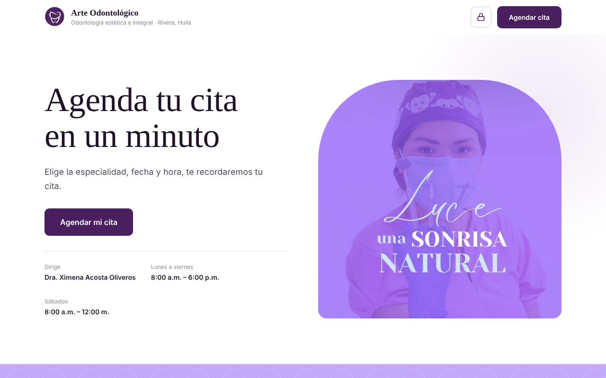{width=90%}

**Descarga e instalación.** No aplica: es una aplicación web.

**Cómo crear una cuenta.** Los pacientes **no tienen cuenta**: para pedir una cita solo se llenan los datos en el formulario. La cuenta de la secretaria la crea el equipo técnico al poner el sistema en marcha; la secretaria recibe su correo y una contraseña temporal. La primera vez que ingresa, el sistema le pide crear una contraseña propia antes de continuar (sección 6).

# 4. Interfaz de usuario

## 4.1 Pantalla de inicio (para todos)

La página principal muestra:

- **Agendar cita:** botón para pedir una cita.
- **Candado:** acceso de la secretaria al panel (también hay un enlace «Acceso del consultorio» al final de la página).
- **Especialidades:** las que ofrece el consultorio; al tocar una se empieza a pedir la cita.
- **Contacto:** dirección (Carrera 7 No. 3-61, Rivera), teléfonos (318 715 3718 y 310 812 0241), horario de atención y un botón para escribir por WhatsApp.

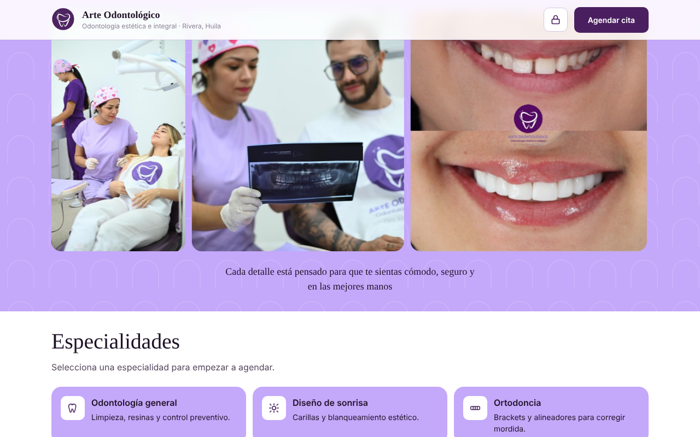{width=90%}

## 4.2 Menú del panel (para la secretaria)

Al iniciar sesión se abre el panel. En computador el menú está a la izquierda y en el celular abajo:

| Sección | Para qué sirve |
|---|---|
| **Inicio** | Resumen del día: citas por atender, citas nuevas de la web, WhatsApp sin enviar. |
| **Agenda** | Todas las citas de un día, con filtros y búsqueda. |
| **Pacientes** | Buscar, registrar y abrir la ficha de cada paciente. |
| **Horarios** | Publicar las horas en que cada especialista atiende. |

Arriba a la derecha está el **menú de la cuenta**: modo oscuro o claro, cambiar contraseña y cerrar sesión.

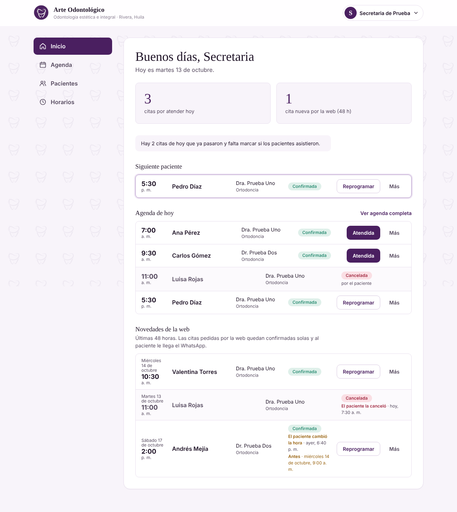{width=95%}

# 5. Funciones principales

## 5.1 Pedir una cita (paciente)

**Paso 1.** En la página principal toque **Agendar cita** o elija una especialidad.

**Paso 2.** Si hay más de un especialista para esa especialidad, elija uno.

**Paso 3.** Elija el día en el calendario. Los días **resaltados** tienen horas disponibles; los demás no se pueden elegir. Con las flechas se cambia de mes.

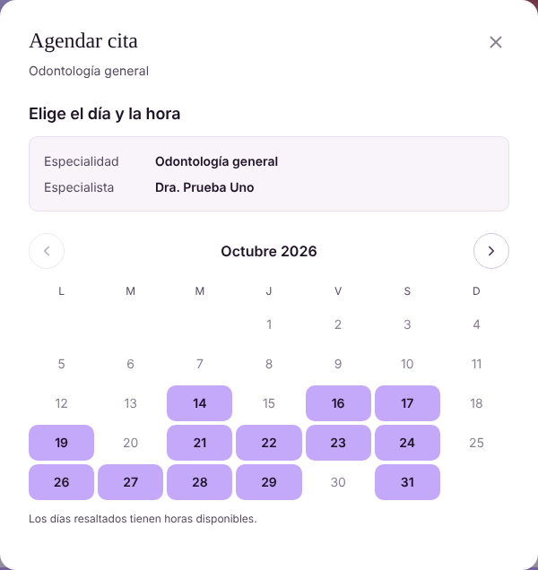{width=60%}

**Paso 4.** Elija una de las horas disponibles de ese día.

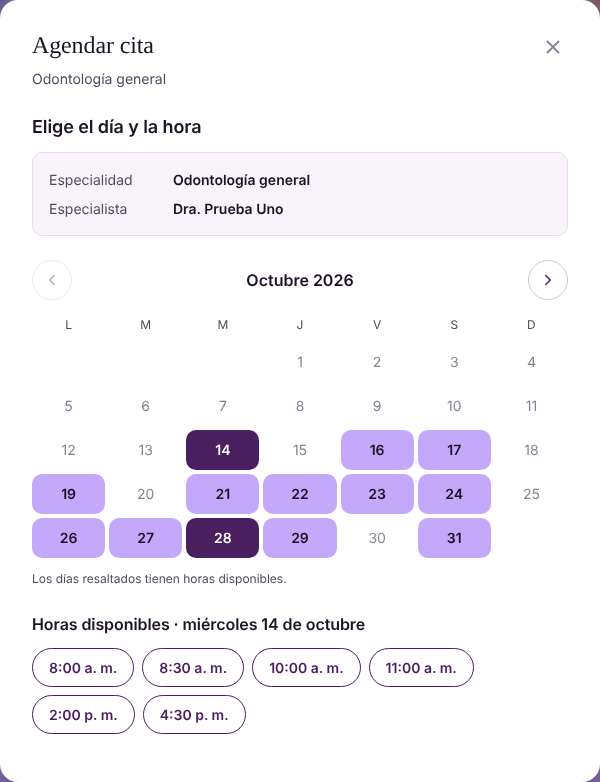{width=60%}

**Paso 5.** Llene sus datos. Son obligatorios: nombres, apellidos, tipo y número de documento, correo electrónico y celular (el de su WhatsApp). El teléfono fijo es opcional. Marque la casilla de **autorización de tratamiento de datos**: sin ella no se puede pedir la cita, porque el consultorio necesita sus datos para agendarla y atenderla (Ley 1581 de 2012). La política completa se abre desde el enlace de la casilla.

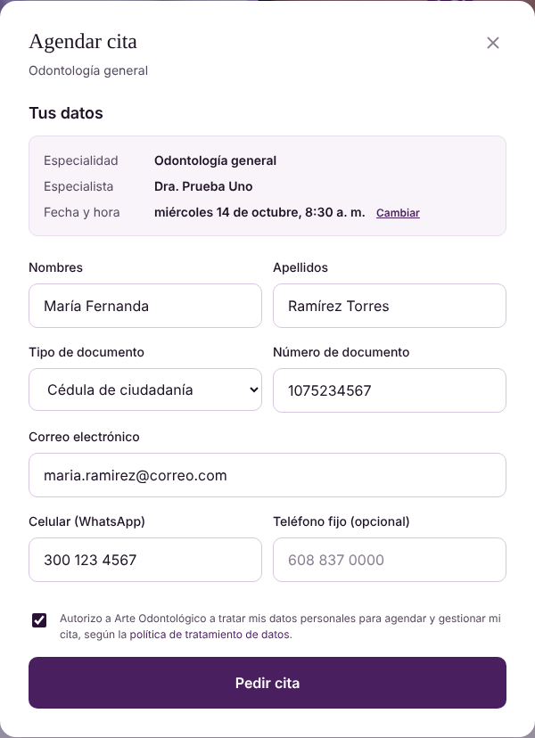{width=60%}

**Paso 6.** Toque **Pedir cita**. La cita queda **confirmada de una vez** y aparece el resumen.

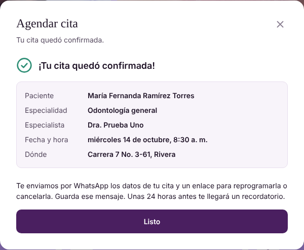{width=60%}

**Paso 7.** Revise su WhatsApp: llega un mensaje con los datos de la cita y un enlace para reprogramarla o cancelarla. **Guarde ese mensaje.**

Reglas que conviene saber:

- Solo se puede tener **una cita activa por número de documento**. Si necesita otra, cancele primero la que tiene.
- Se puede pedir cita para otra persona usando los datos de esa persona. El WhatsApp llega al celular que se escriba en el formulario.

## 5.2 Reprogramar o cancelar la cita (paciente)

Se hace desde el enlace **«Gestionar mi cita»** del WhatsApp. Ese enlace es personal: no lo comparta.

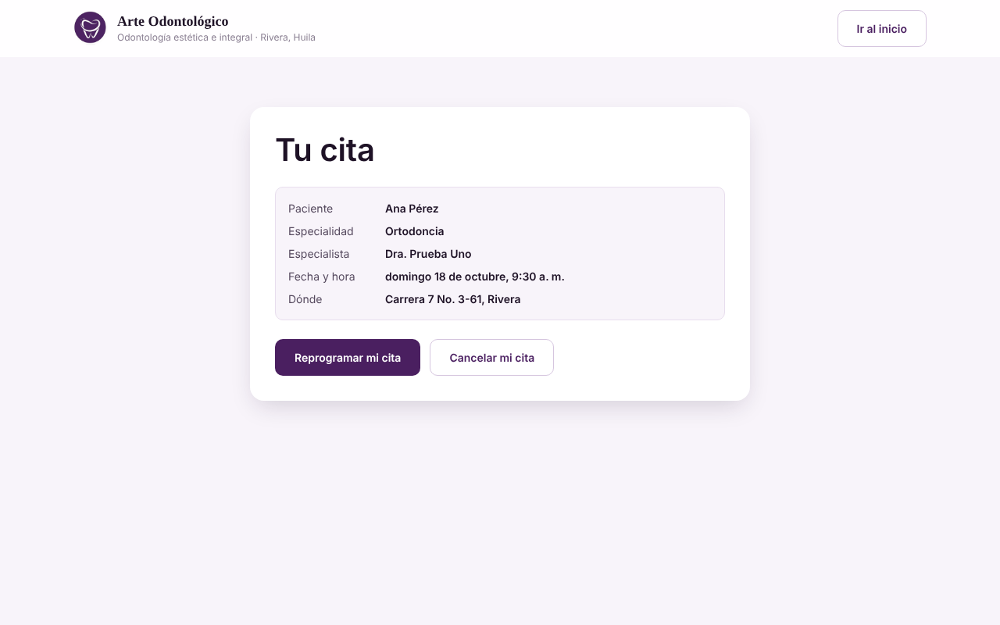{width=90%}

**Reprogramar:**

1. Toque **Reprogramar mi cita**.
2. Elija el nuevo día y la nueva hora.
3. Toque **Confirmar el cambio**. La nueva hora queda confirmada y le llega otro WhatsApp.

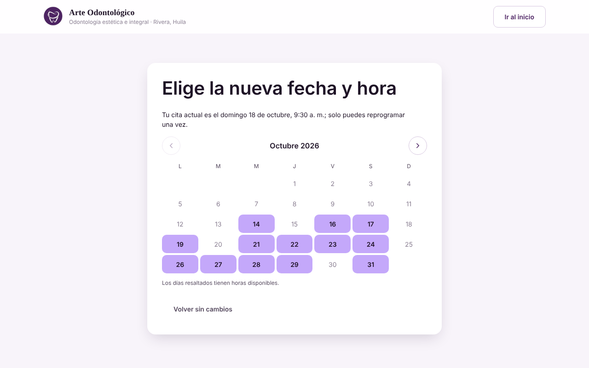{width=90%}

**Cancelar:**

1. Toque **Cancelar mi cita**.
2. Confirme con **Sí, cancelar la cita**. El horario queda libre y puede pedir una cita nueva cuando quiera.

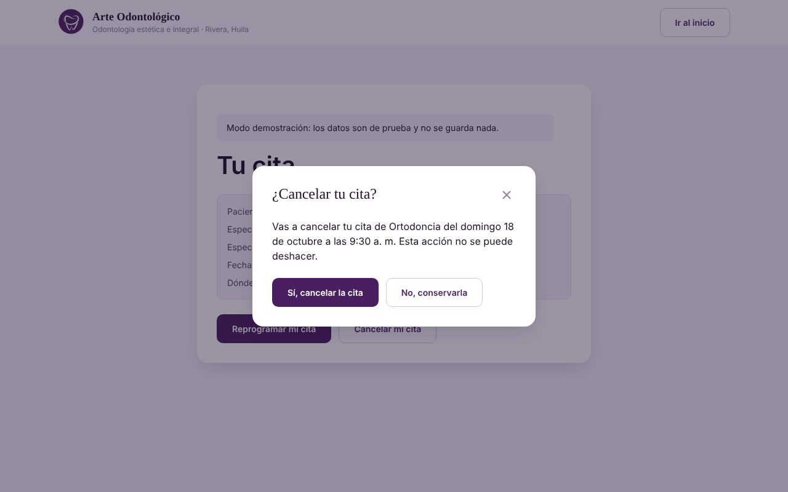{width=90%}

Reglas:

- Se puede reprogramar **una sola vez**.
- Reprogramar o cancelar solo se puede hasta **24 horas antes** de la cita. Pasado ese plazo, escriba o llame al consultorio.
- Después de reprogramar una vez, si necesita otro cambio puede cancelar y pedir una cita nueva.

## 5.3 Si llega directo al consultorio (paciente)

La secretaria lo registra con sus datos, le agenda la cita y le llega el mismo WhatsApp de confirmación, con el enlace para reprogramar o cancelar.

## 5.4 Ingresar al panel (secretaria)

1. En la página principal toque el **candado** junto a «Agendar cita».
2. Escriba su correo y su contraseña y toque **Ingresar**.

{width=30%}

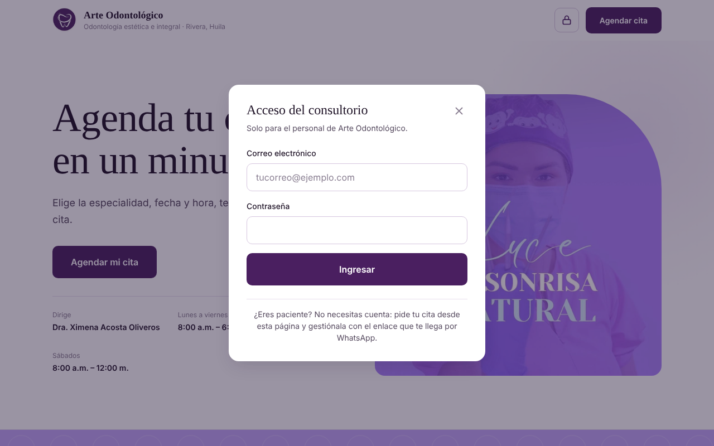{width=90%}

## 5.5 Inicio del panel (secretaria)

Muestra cuántas **citas hay por atender hoy**, el **siguiente paciente**, la agenda del día y las **Novedades de la web** de las últimas 48 horas: citas nuevas pedidas por la web (ya llegan confirmadas) y cambios de hora o cancelaciones que hicieron los pacientes, con la hora anterior. Si quedan citas de hoy que ya pasaron, un aviso recuerda marcar si el paciente asistió.

Si algún WhatsApp no se pudo enviar, aparece arriba como **«WhatsApp sin enviar»** (ver sección 7).

## 5.6 Agenda (secretaria)

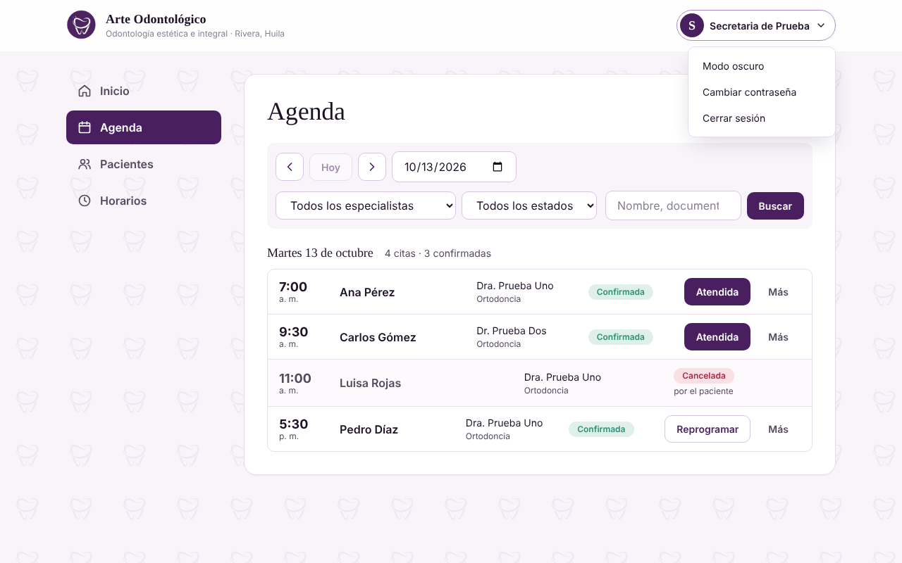{width=95%}

Cada fila muestra la hora, el paciente, el especialista y el estado de la cita. Se puede:

- Cambiar de día, o volver a **Hoy**.
- **Filtrar** por especialista y por estado (Confirmadas, Atendidas, No asistió, Canceladas).
- **Buscar** por nombre, documento o celular.
- Marcar la cita como **Atendida** o **No asistió** (solo cuando ya llegó la hora).
- **Reprogramar** (cambiar a otra hora, incluso con otro especialista de la misma especialidad) o **Cancelar** la cita desde el botón «Más».

En el celular las filas se apilan para que quepan en la pantalla.

## 5.7 Pacientes y ficha del paciente (secretaria)

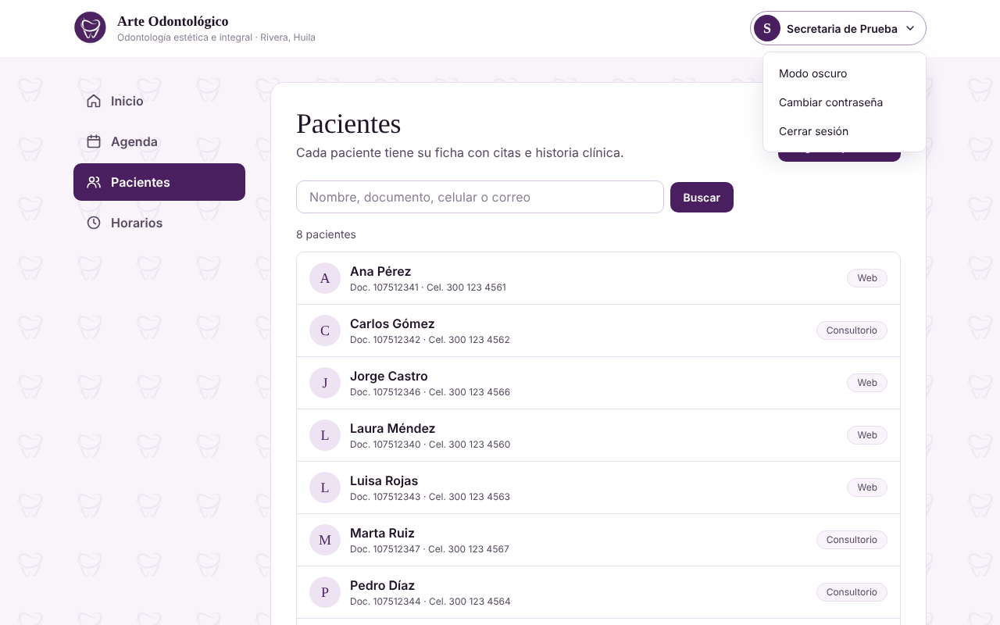{width=95%}

**Registrar a un paciente que llegó al consultorio:**

1. En **Pacientes** toque **Registrar paciente**.
2. Llene nombres, apellidos, tipo y número de documento, correo y celular. El teléfono fijo y el motivo de consulta son opcionales.
3. Confirme que el paciente autorizó el tratamiento de sus datos y toque **Registrar**.

Si el documento ya existe, el sistema lo avisa y ofrece **Abrir su ficha**, para no duplicar pacientes.

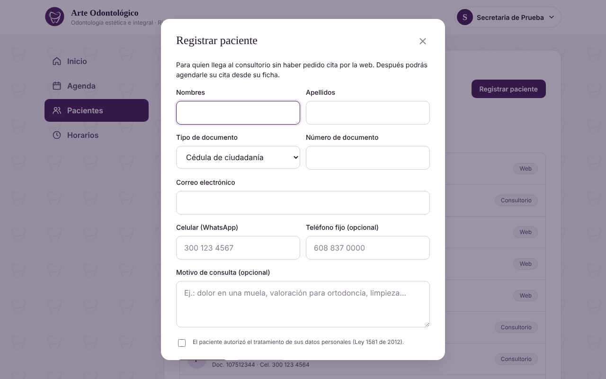{width=90%}

**Ficha del paciente.** Se abre al tocar un paciente de la lista. Reúne sus datos, el botón **Escribir por WhatsApp**, sus citas y su historia clínica.

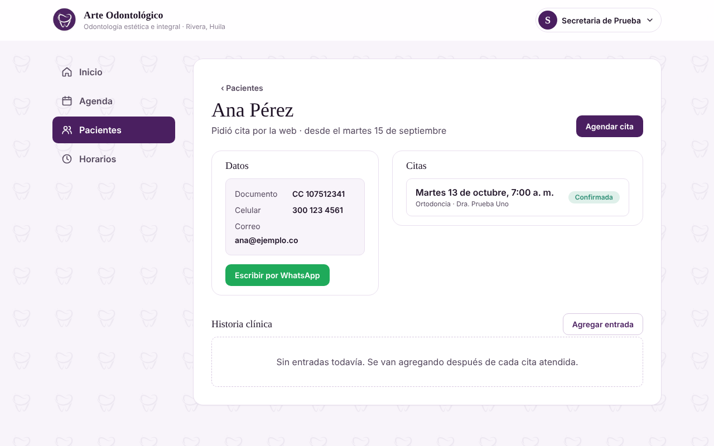{width=95%}

- **Agendar cita:** desde la ficha se elige especialidad, especialista, día y hora; la cita queda confirmada y al paciente le llega el WhatsApp.
- **Historia clínica:** **Agregar entrada** guarda una nota; en una cita atendida, **Agregar a la historia** la deja ligada a esa cita. Una entrada no se borra: **Corregir** la marca como corregida y guarda la corrección como una entrada nueva, para que quede el registro.

## 5.8 Horarios de atención (secretaria)

Aquí se publican las horas en que cada especialista recibe pacientes. Solo esas horas aparecen disponibles en la web.

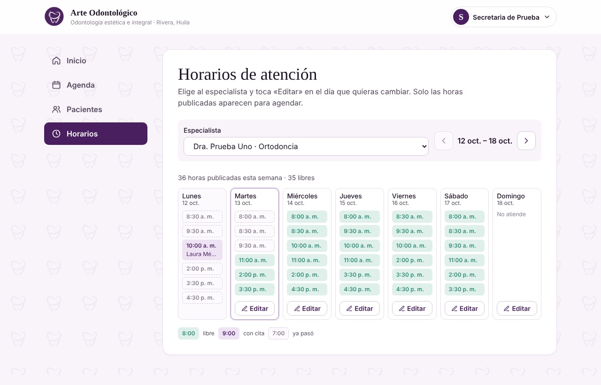{width=95%}

1. Elija al **especialista**. Se ve una semana; con las flechas se cambia de semana.
2. En el día que quiera cambiar toque **Editar**.
3. Se abre el día con las horas de 7:00 a. m. a 7:00 p. m. Las horas **marcadas con ✓** son las que los pacientes pueden elegir. Toque una hora para marcarla o desmarcarla.

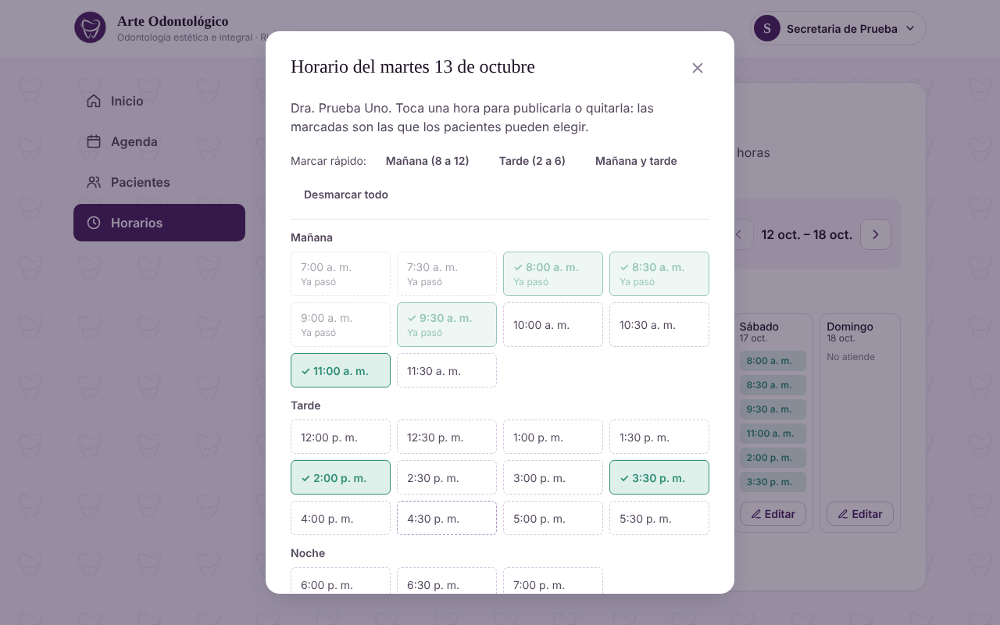{width=80%}

4. Para ir más rápido use los atajos: **Mañana**, **Tarde**, **Mañana y tarde** o **Desmarcar todo**.
5. Para repetir el horario, abra **«Usar este horario en otros días»**, marque los días y cuántas semanas repetir (por ejemplo, de martes a viernes durante 4 semanas).

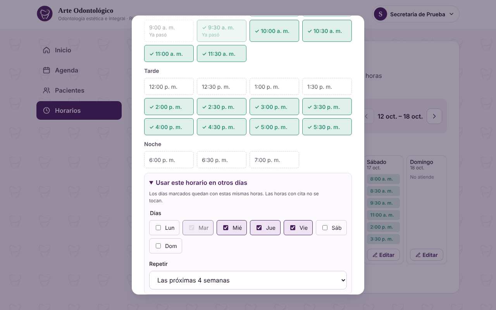{width=80%}

6. Antes de guardar el sistema muestra cuántas horas se van a publicar y cuántas se van a quitar. Toque **Guardar horario**.

Las horas que ya tienen cita aparecen con el nombre del paciente y no se pueden quitar; las que ya pasaron tampoco se cambian. Para mover una cita hay que reprogramarla desde la agenda.

## 5.9 Configuración de preferencias

- **Modo oscuro o claro:** en el menú de la cuenta, opción «Modo oscuro» / «Modo claro». Queda guardado en ese navegador.

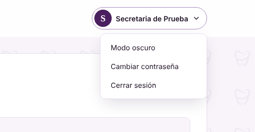{width=45%}

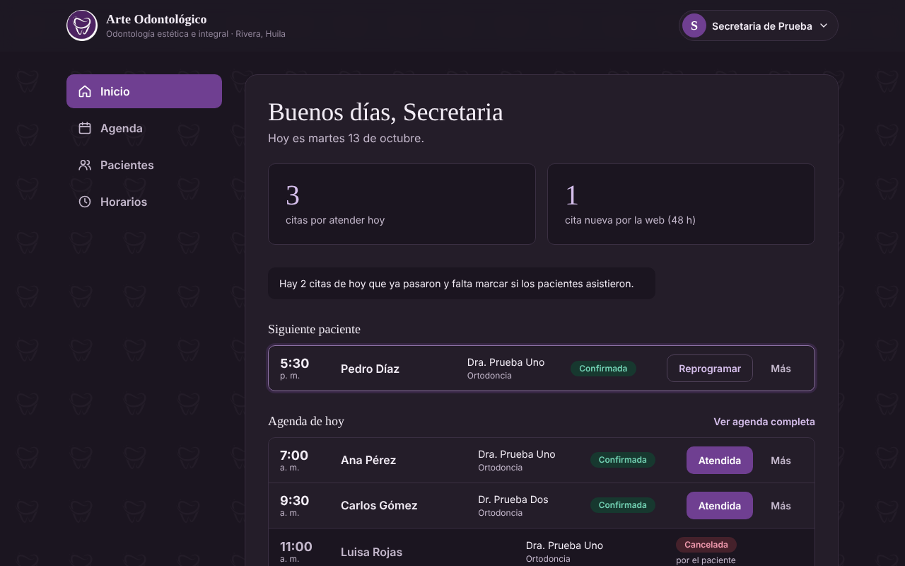{width=90%}

- **Celular:** el panel y la página de citas se adaptan a pantallas pequeñas.

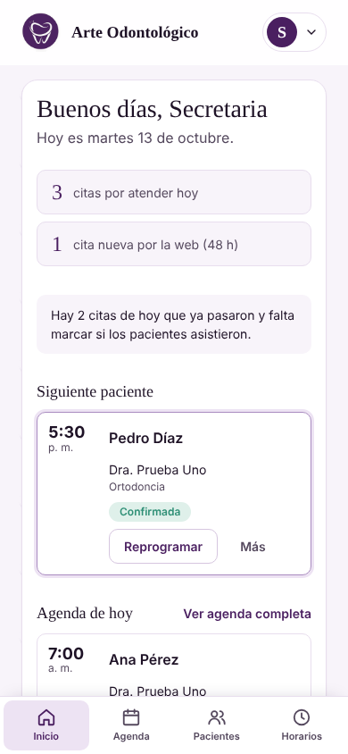{width=35%}

## 5.10 Especialidades y especialistas

En esta versión las especialidades y los especialistas **los configura el equipo técnico** al poner el sistema en marcha o cuando el consultorio lo pida (por ejemplo, para agregar un nuevo especialista o cambiar la descripción de una especialidad). El panel de la secretaria solo administra citas, pacientes y horarios. Una pantalla para que el consultorio los edite por sí mismo está prevista para una versión posterior.

# 6. Gestión de usuarios

**Crear cuenta o perfil.** Los pacientes no tienen cuenta ni perfil: sus datos quedan guardados en su ficha cuando piden o reciben una cita. La cuenta de la secretaria la crea el equipo técnico.

**Primer ingreso (secretaria).** Con la contraseña temporal, el sistema abre la pantalla «Crea tu contraseña»: escriba la temporal como contraseña actual y elija una propia. Sin ese paso no se puede entrar al panel.

**Cambiar la contraseña (secretaria).**

1. En el menú de la cuenta toque **Cambiar contraseña**.
2. Escriba la contraseña actual y la nueva dos veces.
3. Toque **Guardar contraseña**.

La contraseña nueva debe tener entre 8 y 72 caracteres, con al menos una letra y un número.

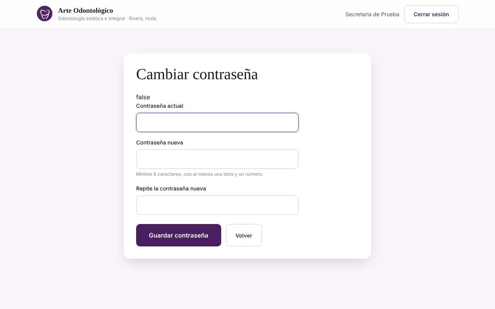{width=80%}

Si olvidó la contraseña, no hay recuperación automática: avise al equipo técnico, que la restablece.

**Roles y permisos.**

| Rol | Cómo entra | Qué puede hacer |
|---|---|---|
| **Paciente** (sin cuenta) | No inicia sesión | Pedir una cita; reprogramarla una vez o cancelarla con el enlace del WhatsApp, hasta 24 horas antes. |
| **Secretaria** (administrador) | Con su correo y contraseña, por el candado | Todo el panel: agenda, pacientes e historia clínica, horarios, registrar pacientes y cambiar citas. |

# 7. Notificaciones y alertas

El sistema avisa por **WhatsApp** al celular que se escribió al pedir la cita. Los mensajes salen solos; la secretaria no tiene que hacer nada. Solo llevan fecha, hora, especialista y dirección: nunca datos de salud.

| Cuándo | Mensaje |
|---|---|
| Al pedir la cita | **Confirmación**, con el enlace «Gestionar mi cita». |
| Al reprogramar | **Reprogramación**, con el enlace por si necesita cancelar. |
| Al cancelar | **Cancelación**, con el enlace para pedir otra. |
| Si el consultorio no puede atender la hora | Aviso para pedir otra hora. |
| Unas 24 horas antes | **Recordatorio**, sin enlace. Si no puede asistir, avise respondiendo ese mensaje. |

Ejemplo de la confirmación:

> Hola María, tu cita en Arte Odontológico quedó confirmada para el miércoles 14 de octubre a las 8:30 a. m. con Dra. Prueba Uno, en Carrera 7 No. 3-61, Rivera. Para reprogramar o cancelar: *[enlace personal]*

**Configurar o desactivar.** Los avisos son parte del servicio y no se desactivan desde el panel. Los recordatorios se revisan cada 30 minutos entre las 8:00 a. m. y las 7:00 p. m.

**Alerta para la secretaria: «WhatsApp sin enviar».** Si el envío automático falla, el aviso aparece en **Inicio**. Toque **Abrir en WhatsApp** (el mensaje ya viene escrito), envíelo desde su celular y toque **Ya lo envié** para quitarlo de la lista.

# 8. Solución de problemas comunes

**Problema 1: No me llegó el WhatsApp.**\
**Causa:** el celular se escribió con un error, o el mensaje tardó.\
**Solución:** espere unos minutos y revise el número en WhatsApp. Si sigue sin llegar, llame o escriba al consultorio (318 715 3718 o 310 812 0241) para que la secretaria lo reenvíe.

**Problema 2: «Esa hora ya no está disponible».**\
**Causa:** otra persona tomó esa hora un momento antes.\
**Solución:** elija otra hora u otro día; el calendario se actualiza solo.

**Problema 3: «Ya tienes una cita confirmada».**\
**Causa:** solo se permite una cita activa por documento.\
**Solución:** cancele la que tiene desde el enlace del WhatsApp y pida la nueva, o reprográmela.

**Problema 4: «No encontramos tu cita».**\
**Causa:** el enlace es de un WhatsApp anterior; si el consultorio cambió la hora, el enlace viejo deja de funcionar.\
**Solución:** use el enlace del último mensaje recibido o escriba al consultorio.

**Problema 5: No puedo reprogramar ni cancelar.**\
**Causa:** faltan menos de 24 horas para la cita, o ya reprogramó una vez.\
**Solución:** comuníquese con el consultorio.

**Problema 6: «Demasiados intentos».**\
**Causa:** se hicieron muchos intentos seguidos desde la misma conexión; es una protección del sistema.\
**Solución:** espere unos minutos y vuelva a intentar.

**Problema 7: No puedo ingresar al panel (secretaria).**\
**Causa:** correo o contraseña incorrectos, o muchos intentos fallidos.\
**Solución:** revise los datos y espere unos minutos si apareció el aviso de demasiados intentos. Si olvidó la contraseña, avise al equipo técnico.

**Problema 8: No puedo quitar una hora del horario.**\
**Causa:** la hora tiene una cita o ya pasó.\
**Solución:** reprograme o cancele primero la cita desde la agenda.

# 9. Glosario

**Agenda:** lista de las citas de un día en el panel.

**Autorización de datos:** permiso que da la persona para que el consultorio use sus datos personales, según la Ley 1581 de 2012.

**Cita:** reserva de un especialista, día y hora. Estados: *Confirmada*, *Atendida*, *No asistió*, *Cancelada* y *Rechazada*.

**Enlace «Gestionar mi cita»:** dirección personal que llega por WhatsApp para reprogramar o cancelar.

**Especialidad:** área de la odontología (por ejemplo, ortodoncia).

**Especialista:** profesional que atiende una o más especialidades.

**Ficha del paciente:** registro del paciente con sus datos, citas e historia clínica.

**Historia clínica:** notas que la secretaria agrega a la ficha después de las citas atendidas. No se borran: se corrigen dejando constancia.

**Horario (franja):** hora en que un especialista atiende y que los pacientes pueden elegir.

**Panel:** parte privada del sistema, solo para la secretaria.

**Recordatorio:** mensaje de WhatsApp que llega unas 24 horas antes de la cita.

**WhatsApp:** aplicación de mensajería por la que el sistema envía los avisos.

# 10. Cierre de sesión y seguridad

**Cerrar sesión (secretaria).** Abra el menú de la cuenta (arriba a la derecha) y toque **Cerrar sesión**. Hágalo siempre al terminar, sobre todo en un equipo compartido.

**Recomendaciones de seguridad.**

- Use una contraseña propia, de 8 caracteres o más, con letras y números, y no la comparta.
- No deje abierto el panel cuando se aleje del computador.
- No reenvíe el enlace «Gestionar mi cita»: con él cualquiera puede cambiar o cancelar esa cita.
- Revise que el celular escrito al pedir una cita sea el del paciente: allí llegan los avisos.
- El sistema no tiene autenticación de dos factores en esta versión.

**Soporte.** Para dudas o problemas con el uso del sistema:

- Consultorio: 318 715 3718 · 310 812 0241 · Carrera 7 No. 3-61, Rivera. Lunes a viernes, 8:00 a. m. a 6:00 p. m.; sábados, 8:00 a. m. a 12:00 m.
- Equipo técnico: Emmanuel Artunduaga Charry (emmanuel_artunduagach@fet.edu.co) y Jawer Leonardo Manrique Yosa (jawer_manriqueyo@fet.edu.co).
